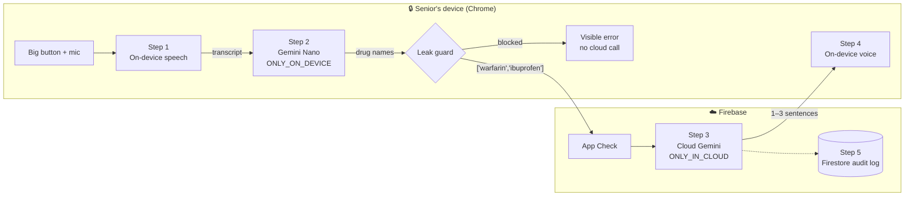

# PillCheck

**Press one big button, say the name of a pill, hear a calm answer.**
PillCheck is a voice-first medication safety checker for seniors, built on **Firebase AI Logic hybrid inference**. Anything that could identify you stays on your device. Only a cleaned list of drug names ever reaches the cloud.

> Status: **Day 2 of 17**, fail-closed on-device guard, one-time on-device setup, spoken refusal. See [docs/PLAN.md](docs/PLAN.md).
> Built for #BuildHybridAI 2026. Licensed under [Apache 2.0](LICENSE).

---

## Why

Meera is 74, lives alone and takes five medicines. When she isn't sure two pills are safe together, she calls her daughter (who may not answer) or skips the dose. Skipped and mixed-up doses send seniors to the hospital every day.

*Evidence (⚠️ figures pending source verification on Day 15; not yet for publication):*
- Seniors account for a disproportionate share of medication errors.
- Home medication errors drive a large number of ER visits each year.
- Adverse drug events among seniors cause hundreds of thousands of hospitalizations a year.
- Nonadherent elderly patients have roughly double the inpatient cost of adherent ones.

## How hybrid inference is used: the routing policy

The routing policy is the product. Each step is pinned to one place, on purpose. Nothing falls back to the cloud silently.

| Step | What | Where | Firebase AI Logic mode | Leaves the device? |
|---|---|---|---|---|
| 1 | Hear the question | Chrome on-device speech recognition (`processLocally: true`) | n/a (browser API) | **No.** Audio and transcript stay local |
| 2 | Pull out drug names | **Gemini Nano** | `InferenceMode.ONLY_ON_DEVICE` | **No** |
| (guard) | Leak guard scans the outbound payload | Local code | n/a | Blocks anything that isn't a known drug name |
| 3 | Check interactions, write 1–3 spoken sentences | **Cloud Gemini** | `InferenceMode.ONLY_IN_CLOUD` | Yes: **drug names only** |
| 4 | Speak the answer | `speechSynthesis` (local voices) | n/a | No |
| 5 | Audit log | Firestore | n/a | Timestamp, drug names, where each step ran, leak-guard result. No audio, no PII |

### Fail-closed, not fail-open
If on-device AI isn't available, PillCheck says **"I can't check safely on this device"** and stops.

> **Verified SDK behaviour (firebase@13.3.0 / @firebase/ai@3.1.0):** the SDK only creates its on-device adapter when `globalThis.LanguageModel` exists. If it doesn't, `callCloudOrDevice()` sends the request **to the cloud even in `ONLY_ON_DEVICE` mode**. [`tests/sdkFallthrough.test.ts`](tests/sdkFallthrough.test.ts) proves it against the real SDK: a transcript containing a patient's name is sent to `firebasevertexai.googleapis.com`, and the response reports `inferenceSource: "in_cloud"`.
>
> PillCheck's [on-device guard](src/guards/onDeviceGuard.ts) therefore:
> 1. **checks before every on-device step** (`assertNanoReady`, `assertLocalSpeechReady`), so private text never reaches the SDK unless Gemini Nano is present and ready;
> 2. **checks after every on-device step** (`assertRanOnDevice(response.inferenceSource)`), so any SDK regression fails loudly instead of leaking quietly;
> 3. **treats "can't tell" as "no"**: a missing API, a thrown error or an unknown state all mean refusal.
>
> When it refuses, the big button still works: it **says** the refusal out loud with a local voice, so Meera hears why nothing happened.

### Testing the refusal (no on-device model)

| How | What you should see |
|---|---|
| `http://localhost:5173/?simulate=no-nano` | Refusal; helper details say "Turned off on purpose for this demo" |
| `?simulate=no-speech` or `?simulate=no-nano,no-speech` | Same, for speech or both |
| A Chrome profile with the Gemini Nano flag **off**, or any non-Chrome browser | Refusal: "doesn't offer Gemini Nano" |
| Press **Check my medicine** on the refusal screen | It speaks: "I can't check safely on this device…" |

`?simulate` works in production builds on purpose: it can only *remove* capabilities, never add or bypass one.

## Architecture



## Before / after

| | Before PillCheck | With PillCheck |
|---|---|---|
| When unsure about a pill | Calls family, waits, or skips the dose | Presses one button and asks out loud |
| Time to an answer | Minutes to hours, or never | Seconds |
| Skill needed | Reading tiny leaflet print, typing | Speaking |
| Privacy | n/a | Voice and identity never leave the device; the cloud sees drug names only |
| If the device can't run AI locally | n/a | Clear refusal, never a silent upload |

## Setup

**Prerequisites:** Node 22+, Chrome desktop 139+ on a machine with a GPU (>4 GB VRAM) or 16 GB RAM, ≥22 GB free disk, a Firebase project.

1. **Chrome:** open `chrome://flags/#prompt-api-for-gemini-nano-multimodal-input` → *Enabled* → restart. In DevTools, `await LanguageModel.availability()` should return `available`, `downloadable` or `downloading`.
2. **Firebase console:**
   1. Add a **Web app** and copy its config.
   2. **AI Logic** → Get started → Gemini Developer API.
   3. **Authentication** → Sign-in method → enable **Anonymous**.
   4. **App Check** → register the web app with **reCAPTCHA Enterprise** (score-based key, your Hosting domains, *not* localhost).
3. **Local config:**
   ```bash
   cp .env.example .env.local   # then fill in the values
   npm install
   npm run dev
   ```
4. **App Check debug token:** open http://localhost:5173, copy the debug token printed in the browser console, and add it under App Check → Apps → ⋮ → *Manage debug tokens*. Reload.

   *Tip:* set `VITE_APPCHECK_DEBUG_TOKEN` in `.env.local` to a fixed UUID (`uuidgen`) and register that value once; then every local browser shares it.
5. **One-time on-device setup:** if speech recognition or Gemini Nano isn't downloaded yet, PillCheck shows **Set up PillCheck**. Click it once; it installs the US-English speech pack and downloads Gemini Nano, with progress.
6. **Tests:** `npm test` (unit tests for the guard plus the SDK fall-through evidence test).

You should see the **System check** panel with Firebase ✓, App Check ✓, Anonymous sign-in ✓ and the on-device capability rows.

## Demo script (draft, finalised on Day 15)

1. Meera presses **Check my medicine**: "Can I take ibuprofen?" → spoken answer naming her blood thinner. The provenance strip shows *heard on-device → understood on-device → checked in cloud → spoken on-device*.
2. **Leak guard:** inject "for Meera Sharma, born 3 Dec 1951" → the cloud call is blocked, with a visible error and an audit entry.
3. **No on-device model:** a Chrome profile without the flag → "I can't check safely on this device." DevTools Network shows zero requests to the model.
4. **Offline replay:** Wi-Fi off → the last answer replays with the local voice.
5. **Privacy receipt:** the Firestore audit log shows drug names and inference sources only.

## Repo map

```
src/firebase/     App, App Check, Auth (AI Logic, Firestore, Remote Config to come)
src/guards/       onDeviceGuard.ts (fail-closed, Day 2) · leak guard (Day 5)
src/pipeline/     step4-speak.ts (local voices only) · Steps 1–3, 5 + routing policy (Days 3–7)
src/ui/           RefusalScreen, SetupCard, SystemCheck
tests/            onDeviceGuard.test.ts · sdkFallthrough.test.ts (evidence)
docs/             plan, architecture, evidence, demo script
```

## License

Apache License 2.0. See [LICENSE](LICENSE).
PillCheck is not medical advice and is not a substitute for a pharmacist or doctor.
