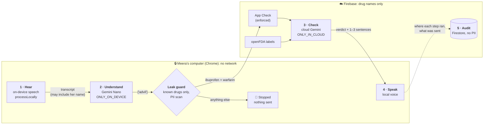

# PillCheck

**Press one big button, say the name of a pill, hear a calm answer.**
PillCheck is a voice-first medication safety checker for seniors, built on **Firebase AI Logic hybrid inference**. Anything that could identify you stays on your device. Only a cleaned list of drug names ever reaches the cloud.

> **Live: https://pillcheck-by-v1h44n.web.app** (Chrome desktop with Gemini Nano; see [Setup](#setup)). App Check is enforced on Firebase AI Logic and Cloud Firestore. Safety evaluation **30/30**, **231 unit tests + 12 security-rules tests**, Lighthouse accessibility **100**.
> Built for #BuildHybridAI 2026. Licensed under [Apache 2.0](LICENSE).

---

## Why

Meera is 74, lives alone and takes five medicines, one of them warfarin. Her knee hurts. Is it safe to take Advil? The leaflet print is tiny, her daughter isn't answering, and typing a long drug name into a search box is hard. So she either guesses or goes without.

That guess is where the harm is:

- **About 1 in 6 older Americans (15.1%) were at risk of a potential major drug–drug interaction** in 2010–11, up from 8.4% in 2005–06. **35.8% took five or more prescription medicines at once.** ([Qato et al., *JAMA Internal Medicine* 2016](https://doi.org/10.1001/jamainternmed.2015.8581))
- **Adults 65 and over visit US emergency departments for adverse drug events more than 600,000 times a year**, more than twice as often as younger people. Anticoagulants (21%) and diabetes medicines such as insulin (14%) are the leading causes. ([CDC, Medication Safety Data](https://www.cdc.gov/medication-safety/data-research/facts-stats/index.html))
- **About 100,000 emergency hospitalizations a year of adults 65+ are caused by adverse drug events** (2007–09). Nearly half were people over 80, and **warfarin alone was involved in one in three.** ([Budnitz et al., *NEJM* 2011](https://doi.org/10.1056/NEJMsa1103053))

PillCheck is for the moment before the pill: one button, one spoken question, and a calm answer that sends her to the pharmacist when it matters. Her voice, her name and her questions stay on her own computer.

## How hybrid inference is used: the routing policy

The routing policy is the product. Each step is pinned to one place, on purpose. Nothing falls back to the cloud silently. The policy lives in code at [`src/pipeline/policy.ts`](src/pipeline/policy.ts), and the UI's "Heard on this device" style labels come from it.

| Step | What | Where | Firebase AI Logic mode | Leaves the device? |
|---|---|---|---|---|
| 1 | Hear the question | Chrome on-device speech recognition (`processLocally: true`) | n/a (browser API) | **No.** Audio and transcript stay local |
| 2 | Pull out drug names | **Gemini Nano** | `InferenceMode.ONLY_ON_DEVICE` | **No** |
| (guard) | Leak guard scans the outbound payload | Local code | n/a | Blocks anything that isn't a known drug name |
| 3 | Check interactions, write 1–3 spoken sentences | **Cloud Gemini** | `InferenceMode.ONLY_IN_CLOUD` | Yes: **drug names only** |
| 4 | Speak the answer | `speechSynthesis` (local voices) | n/a | No |
| 5 | Audit log | Firestore | n/a | Timestamp, drug names, where each step ran, leak-guard result. No audio, no PII |

### Fail-closed, not fail-open
If on-device AI isn't available, PillCheck says **"I can't check safely on this device"** and stops.

> **Verified SDK behaviour (firebase@13.3.0 / @firebase/ai@3.1.0):** the SDK only creates its on-device adapter when `globalThis.LanguageModel` exists. If it doesn't, `callCloudOrDevice()` sends the request **to the cloud even in `ONLY_ON_DEVICE` mode**. [`tests/sdkFallthrough.test.ts`](tests/sdkFallthrough.test.ts) proves it against the real SDK: a transcript containing a patient's name is sent to `firebasevertexai.googleapis.com`, and the response reports `inferenceSource: "in_cloud"`.
>
> PillCheck's [on-device guard](src/guards/onDeviceGuard.ts) therefore:
> 1. **checks before every on-device step** (`assertNanoReady`, `assertLocalSpeechReady`), so private text never reaches the SDK unless Gemini Nano is present and ready;
> 2. **checks after every on-device step** (`assertRanOnDevice(response.inferenceSource)`), so any SDK regression fails loudly instead of leaking quietly;
> 3. **treats "can't tell" as "no"**: a missing API, a thrown error or an unknown state all mean refusal.
>
> When it refuses, the big button still works: it **says** the refusal out loud with a local voice, so Meera hears why nothing happened.

### Testing the refusal (no on-device model)

| How | What you should see |
|---|---|
| `http://localhost:5173/?simulate=no-nano` | Refusal; helper details say "Turned off on purpose for this demo" |
| `?simulate=no-speech` or `?simulate=no-nano,no-speech` | Same, for speech or both |
| A Chrome profile with the Gemini Nano flag **off**, or any non-Chrome browser | Refusal: "doesn't offer Gemini Nano" |
| Press **Check my medicine** on the refusal screen | It speaks: "I can't check safely on this device…" |

`?simulate` works in production builds on purpose: it can only *remove* capabilities, never add or bypass one.

### Step 1: how "on-device listening" is enforced

[`step1-transcribe.ts`](src/pipeline/step1-transcribe.ts) refuses unless **all** of these hold:
1. the on-device guard reports the US-English speech pack as `available`;
2. the recogniser exposes `processLocally`, and reading it back after setting it to `true` returns `true`;
3. no `network` error occurs. On-device recognition needs no network, so a network error means the browser tried a server, and PillCheck refuses instead of retrying.

**It hears drug names correctly, on the device.** Before biasing, the on-device recogniser heard "Can I take Advil?" as *"Can I take Behind Patel?"*. PillCheck now passes Chrome's contextual-biasing phrases (`SpeechRecognitionPhrase`) to the local recogniser: her own medicines get the strongest boost, then 65 brand and generic names older adults commonly take ([`biasPhrases.ts`](src/data/biasPhrases.ts)). Every phrase must be in the lexicon. If a browser rejects phrases, PillCheck retries once without them, still on the device.

The transcript lives only in memory: it isn't logged, stored or sent.

### Step 2: the privacy airlock (Gemini Nano, `ONLY_ON_DEVICE`)

[`step2-extract.ts`](src/pipeline/step2-extract.ts) turns the full transcript (which might include a name, a birthday or a dose) into a bare list such as `["advil", "warfarin"]`:

- `getGenerativeModel(ai, { mode: InferenceMode.ONLY_ON_DEVICE, onDeviceParams: { createOptions, promptOptions: { responseConstraint } } })`
- **Guard before, check after:** `assertNanoReady()` runs before the transcript is handed to the SDK, and `assertRanOnDevice(response.inferenceSource)` runs on the result.
- **Instructions go in `createOptions.initialPrompts` (role `system`), not `systemInstruction`.** Verified in the SDK source: the on-device path only forwards `createOptions` and the request contents to Chrome's Prompt API. A `systemInstruction` would silently never reach Nano.
- **Structured output on-device:** a JSON Schema is passed as `responseConstraint`, so Nano must answer `{"medicines": [...]}` (max 5 names, 40 characters each). A first-pass clean-up drops anything with digits, `@`, `/` and the like, before the full leak guard below.

**Try it without speaking (dev builds only):** in the DevTools console at localhost, run

```js
await __pillcheck.extract("This is Meera, born March 3rd. Can I take two Advil with my warfarin?")
// → { medicines: ["advil", "warfarin"], where: "on-device", inferenceSource: "on_device" }
```

**Tests run the browser build of Firebase AI Logic.** Under Node, `firebase/ai` resolves to a build with *no* on-device adapter, where everything goes to the cloud. [`vitest.config.ts`](vitest.config.ts) aliases it to the browser build, and a control test proves that (Nano present → zero network requests).

### The leak guard: what is allowed to leave

[`leakGuard.ts`](src/guards/leakGuard.ts) runs on everything bound for the cloud. **Any finding is a hard block**: nothing is sent, the screen shows why, and PillCheck says so out loud.

| Check | What it catches |
|---|---|
| **Shape** | Anything but `{ medicines: string[], cabinet?: string[] }`, e.g. an extra `patientName` field |
| **Structural PII** (runs on every entry) | emails, ID numbers, dates, phone numbers, addresses, any digits (doses, ages, times) |
| **Allowlist** | every entry must be a known medicine in the [openFDA lexicon](src/data/drug-lexicon.json) (2,000+ ingredients, thousands of brands, public domain) |
| **Word PII** (only on unknown entries) | titles (Mrs, Dr), personal phrases ("my name is", "born"); 2–3 unknown words are flagged as a *possible name* |
| **Rebuild** | the payload is **rebuilt from canonical ingredient names in the lexicon**. "Advil" becomes `ibuprofen`, so Meera's own words are never what's sent |

**The lexicon's own safety rules** ([`scripts/build-lexicon.ts`](scripts/build-lexicon.ts), `npm run build:lexicon`):
- only brands taken by mouth;
- a brand is kept **only if every product under that name has the same ingredients**. Store brands like "Equate" or "CVS" sell dozens of different drugs under one name, and mapping them would check the wrong drug;
- no entry contains a digit or symbol, enforced by a test.

**"Did you mean…?" (a backstop for mishearings).** If the block is *only* about unknown medicine words, and each one is a clear near-miss of a well-known medicine, Meera sees **"Did you mean Coumadin?"** and a big **Yes, check Coumadin** button ([`suggest.ts`](src/data/suggest.ts)).
- The suggestion is computed **on the device** from the lexicon. Nothing is sent until she presses the button, and the corrected names then go through the leak guard, Step 3 and the audit as usual.
- It allows at most 1 edit for short names and 2 for long ones, needs the same first letter, and gives no suggestion on a tie.
- Candidates are curated aliases, common medicines and ingredients of 8+ letters. It never offers when anything personal was found.
- A test checks that ~30 common first names and surnames (Meera, Patel, Cooper…) are never "corrected" into a medicine.

**Demo the block:** open `http://localhost:5173/?simulate=inject-pii`, press the button and say "Can I take ibuprofen?". A fictional name and birthday are added after Nano (simulating a model that leaked them), and you get **🛑 Stopped before sending**: *"What looks like a person's name: 'Meera Sharma'"*, *"A date: '12/03/1951'"*, *Nothing left this device*.

### Step 3: the interaction check (cloud Gemini, `ONLY_IN_CLOUD`)

[`step3-check.ts`](src/pipeline/step3-check.ts) is the only step that sends anything off the device:

1. **Leak guard again, inside Step 3** (`assertSafeToSend`), immediately before the network, so no caller can skip it.
2. **Grounding in official FDA labels.** [`labelGrounding.ts`](src/pipeline/labelGrounding.ts) fetches the *drug interactions*, *boxed warning*, *ask a doctor* and *use in older adults* sections from the public openFDA label API, for the cleaned ingredient names only.
3. **Gemini, `InferenceMode.ONLY_IN_CLOUD`**, behind App Check with limited-use tokens, returns JSON (`responseSchema`): `verdict` (ok / caution / avoid / unsure), `spoken` (1–3 sentences, under 50 words, written to be heard), optional `waitHours`, and `interactions`.
4. **Validation before Meera hears anything:** the verdict must be one of the four; at most 3 sentences; interactions may only name medicines that were actually sent; `waitHours` must be 1–48.
5. **Personalised on-device:** the cloud saw `calcium carbonate`, but Meera said "Tums", so the name she used is put back locally after the answer arrives.

**Why the cloud for this step, and no on-device fallback:** a safety call about drug interactions needs the larger model plus label grounding. If the cloud is unreachable, PillCheck says *"I couldn't check right now… ask your pharmacist"*. It never lets Nano say "that's safe".

**Cloud models, tried in order:** `gemini-3.5-flash-lite`, then `gemini-3.8-flash` (both cloud, same payload; the list comes from [Remote Config](#remote-config-tune-it-never-weaken-it)). **Each model gets 15 seconds**, and each FDA label request gets 6 seconds. After that, PillCheck moves to the next model and finally says *"I couldn't check right now… ask your pharmacist"*. It never leaves Meera waiting.

**Live results** (real Gemini, real FDA labels):

| Asked | Verdict | Spoken answer |
|---|---|---|
| Advil, while on warfarin | **avoid** | "Please don't take ibuprofen while you are on warfarin. Using them together greatly raises your risk of serious bleeding. Check with your doctor or pharmacist first." |
| Synthroid + Tums | **caution**, waitHours 4 | "…you need to wait at least four hours between them so your body can absorb your thyroid medicine properly." |
| Tylenol, while on warfarin + lisinopril | **caution** | "…taking acetaminophen while you take warfarin requires caution because it can affect your bleeding risk…" |

**Safety evaluation: 30/30.** 20 dangerous pairs (warfarin + ibuprofen, sildenafil + nitroglycerin, oxycodone + alprazolam…) and 10 safe ones, run against live Gemini through the full pipeline: **0 missed dangers, 0 over-warnings**, 2.5–4.5 s per answer. Details and the hang it uncovered (now fixed with timeouts): [docs/eval-results.md](docs/eval-results.md).

**Try Step 3 without speaking (dev builds):** `await __pillcheck.check(["advil"], ["warfarin"])` in the console at localhost.

### Step 5: an audit log that can't hold private data

Every check writes one entry to `users/{anonymous uid}/audit/{id}` in Cloud Firestore ([`step5-audit.ts`](src/pipeline/step5-audit.ts)), recording **where each step actually ran** and **exactly what left the device**:

```json
{
  "outcome": "answered",
  "route": { "transcribe": "on-device", "extract": "on-device", "check": "cloud", "speak": "on-device" },
  "inferenceSource": { "extract": "on_device", "check": "in_cloud" },
  "leakGuard": { "result": "passed", "findings": [] },
  "sent": { "medicines": ["ibuprofen"], "cabinet": ["warfarin"] },
  "verdict": "avoid", "model": "gemini-3.5-flash-lite", "grounded": ["ibuprofen", "warfarin"],
  "demo": { "injectedPii": false, "simulate": [] },
  "at": "<server time>", "schemaVersion": 1, "appVersion": "0.1.0"
}
```

It's private by construction, with three layers:
1. **Builder:** entries are assembled only from fixed status words, finding *types* and the canonical ingredient names that were actually sent. Never the transcript, never "Advil", never the text the guard caught.
2. **Client check:** `assertAuditSafe` rejects any string outside that closed vocabulary.
3. **[Security rules](firestore.rules):** own UID only, **append-only** (no edits or deletes), exact field list, enum values, server timestamp. They also check consistency: a *blocked* entry must show nothing sent, and `extract` can only ever be `on_device`, so the log can't even record Step 2 in the cloud. Rules tests: [`tests/rules/`](tests/rules/firestore.rules.test.ts), **12 cases, all passing on the Firestore emulator**. Run with `npm run test:rules`. It needs Java 21+: `brew install openjdk@21`, then `export PATH="/opt/homebrew/opt/openjdk@21/bin:$PATH"`. The emulator uses port 8181.

Audit writes are fire-and-forget: a slow or offline Firestore never delays the spoken answer.

### My medicines: kept on the device

Meera (or a family member, once) presses **＋ Add a medicine** and says *"I take Coumadin and Lipitor"*. From then on, every check includes them as `already_taking`.

- **Stored only in this browser** ([`cabinet.ts`](src/cabinet/cabinet.ts), `localStorage`), never in Firestore. A list of someone's medicines is health data, and the anonymous account belongs to this browser anyway, so the cloud would add risk without adding sync.
- **Added using Steps 1–2 only** ([`addByVoice.ts`](src/cabinet/addByVoice.ts)): on-device speech → Gemini Nano → lexicon. **No network request at all**, and a test asserts `fetch` is never called.
- **Only recognised medicines can be stored**, and stored data is re-checked against the lexicon on every load. So the list can't hold a name or a note, even if someone edits storage by hand.
- **Leaves the device only inside a check**, as canonical ingredient names after the leak guard. Gemini sees `warfarin`, and Meera still hears *"Please don't take Advil with your **Coumadin**…"* (live result), because her names are put back on-device.
- **Removing takes two taps** ("Remove" → "Tap again to remove"), so one stray tap can't silently take warfarin off the list every check depends on.

### Where did each step run? The provenance strip

Every check shows a live strip of six steps, each labelled with **where it runs**, from the [routing policy](src/pipeline/policy.ts):

| Heard | Understood | Privacy check | Checked | Spoken | Logged |
|---|---|---|---|---|---|
| 🔒 This device | 🔒 This device | 🔒 This device | ☁️ Cloud | 🔒 This device | ☁️ Cloud |

Each step shows *waiting → in progress → done*, or *blocked / skipped / didn't work*. In the leak-guard demo it shows **Privacy check: Stopped** and **Checked: Nothing sent**. "Logged" reflects the real Firestore write result. ([`provenance.ts`](src/ui/provenance.ts) is a pure, tested mapping.)

### Remote Config: tune it, never weaken it

[`remoteConfig.ts`](src/firebase/remoteConfig.ts) and [`remoteconfig.template.json`](remoteconfig.template.json) (`npx firebase deploy --only remoteconfig`):

| Key | Effect | Safety limit |
|---|---|---|
| `step3_cloud_models` | Cloud Gemini models for Step 3, tried in order | All entries must be `gemini-*`, up to 4; one bad entry and the defaults are used |
| `step3_max_output_tokens` | Answer length budget | Clamped to 256–2048 |
| `listen_max_ms` | Longest the mic stays open | Clamped to 5–30 s |
| `checks_paused` / `checks_paused_message` | **Kill switch**: checks refuse with a spoken message | Plain text, max 200 characters |

**By design, no key can move a step between device and cloud, disable a guard, or widen what is sent.** The inference modes are hard-coded, and a test pins the key list. The worst a bad config can do is pause PillCheck, which makes it refuse; it can't make it leak.

**Verified live:** publishing `checks_paused: true` paused the running app on its next config fetch ("PillCheck is paused for a quick update…"), with no new build. Publishing `false` restored it.

### Designed for Meera (74, reading glasses, distrusts apps)

| Choice | Why |
|---|---|
| **Atkinson Hyperlegible**, 20px base, 1.55 line height | Typeface designed by the Braille Institute for low-vision readers. **Bundled with the app**, so no request goes to a font CDN |
| **WCAG AAA contrast (≥ 7:1)** for every text colour, light and dark | [`tests/contrast.test.ts`](tests/contrast.test.ts) reads the tokens from the stylesheet and fails the build if any pair drops below 7:1. It also bans `opacity` on text |
| `prefers-contrast: more` → pure black/white, thicker borders | For people who've turned on "Increase contrast" |
| One 7rem microphone button; busy state says **"Please wait…"** at full contrast | A faded button reads as "broken" |
| 🔒 *"Your voice stays on this computer. Only medicine names are checked online."* | The trust question is answered before she has to ask it |
| **Answer first**, then the provenance strip (2×3 tiles on phones) | What she needs comes before how it was done |
| Answer text in regular weight at 1.55rem; only the verdict is bold | Long bold paragraphs are harder to read |
| Removing a medicine takes two taps | One stray tap can't drop warfarin from every future check |
| Technical details in a collapsed **"For family & helpers"** drawer | Her screen stays simple; a helper or judge can open the privacy explanation (from the routing policy) and the System check |
| Gentle scale-only pulses, removed under `prefers-reduced-motion` | No motion she didn't ask for |
| Space reserved while the device check runs | No content jumping (Lighthouse CLS fixed) |
| Firestore loads only when it's first needed (audit, receipt) | First-screen JavaScript **311 → 171 KB** gzipped |

**Lighthouse (mobile):** Accessibility **100**, Best Practices **100**, SEO **100** on the main screen, and Accessibility 100 on the dev-only state gallery (`localhost:5173/?gallery`, every screen with sample data) in both light and dark. Before this pass the gallery scored 96: fading waiting/skipped steps with opacity had dropped their text below 4.5:1.

### Security in production (verified live, 14 Nov 2026)

| Layer | What it does | Verified |
|---|---|---|
| **App Check, enforced** on Firebase AI Logic and Cloud Firestore | Only the genuine PillCheck web app (reCAPTCHA Enterprise score-based attestation) can call Gemini or touch the database. AI Logic calls use **limited-use tokens** (replay protection) | Gemini request with **no** token → `401 UNAUTHENTICATED: Firebase App Check token is invalid`; with a **forged** token → the same `401`. The live app, with its real token, still reads and writes Firestore |
| **Content Security Policy** (`firebase.json`) | `connect-src` lists every server the page may contact: Firebase + openFDA. **The browser refuses everything else**, even from a compromised dependency | From the live page: `api.fda.gov` → 200; `example.com` and another Google API → *"Refused to connect… violates the document's Content Security Policy"*. [`tests/security.test.ts`](tests/security.test.ts) pins the list |
| **Permissions-Policy** | Microphone for this site only; camera, location, payment, USB off | Live headers checked |
| **No debug token in production** | App Check debug settings live in `.env.development.local`, which production builds never read | A whole-object `import.meta.env` default had been inlining every `VITE_*` value, the debug token included, into the bundle. **Caught before the first deploy**, fixed, and guarded by a test that fails on the old code |
| Firestore rules | Own UID only, append-only, schema-checked | 12 emulator tests |
| `Referrer-Policy: no-referrer`, `nosniff`, HSTS, `frame-ancestors 'none'` | Standard hardening | Live headers checked |

**Deploy:** `npm run deploy:hosting` (build + `firebase deploy --only hosting`).

### The pipeline in one file

[`orchestrator.ts`](src/pipeline/orchestrator.ts) runs Steps 1–5 for each press of the button, with every step injected so [`tests/orchestrator.test.ts`](tests/orchestrator.test.ts) can drive the whole flow with fakes. That includes the inject-PII demo (blocked, no cloud call, audit holds finding types only) and each refusal path.

**Try it:** press **Check my medicine** and say "Can I take ibuprofen?". The words appear as you speak, then "You asked: …", the medicine names, the privacy check, and the spoken answer, while the provenance strip fills in step by step. With DevTools → Network open, **no request** is made while you speak or while Nano works. The first request is the cleaned drug names going to Step 3. Press the button again ("I'm done talking") to stop early. Stay silent and it says "I didn't hear anything…".

## Architecture



Everything in the left box runs on the device, with no network. Only two things cross into the cloud: canonical drug names (Step 3) and a privacy-safe audit record (Step 5) of **where each step actually ran**, as reported by the SDK.

Not drawn, to keep it readable:
- **My medicines** stay in `localStorage` and join the check as canonical names after the leak guard.
- **"Did you mean…?"** loops back into the leak guard once Meera confirms.
- **Remote Config** sets the cloud models, limits and kill switch.
- If Nano or local speech is missing, the app **refuses** before Step 1 or 2. Blocks and refusals are audited too.

## Before / after

| | Before PillCheck | With PillCheck |
|---|---|---|
| When unsure about a pill | Calls family, waits, or skips the dose | Presses one button and asks out loud |
| Time to an answer | Minutes to hours, or never | Seconds |
| Skill needed | Reading tiny leaflet print, typing | Speaking |
| Privacy | n/a | Voice and identity never leave the device; the cloud sees drug names only |
| If the device can't run AI locally | n/a | Clear refusal, never a silent upload |

## Setup

**Prerequisites:** Node 22+, Chrome desktop (developed and tested on Chrome 156) on a machine with a GPU (>4 GB VRAM) or 16 GB RAM, ≥22 GB free disk, a Firebase project.

1. **Chrome:** open `chrome://flags/#prompt-api-for-gemini-nano-multimodal-input` → *Enabled* → restart. In DevTools, `await LanguageModel.availability()` should return `available`, `downloadable` or `downloading`.
2. **Firebase console:**
   1. Add a **Web app** and copy its config.
   2. **AI Logic** → Get started → Gemini Developer API.
   3. **Authentication** → Sign-in method → enable **Anonymous**.
   4. **Firestore Database** → Create database → production mode. Then deploy the rules:
      ```bash
      cp .firebaserc.example .firebaserc   # put your project ID in it
      npx firebase login
      npm run deploy:rules
      ```
   5. **App Check** → register the web app with **reCAPTCHA Enterprise** (score-based key, your Hosting domains, *not* localhost).
3. **Local config:**
   ```bash
   cp .env.example .env.local   # then fill in the values
   npm install
   npm run dev
   ```
4. **App Check debug token:** open http://localhost:5173, copy the debug token printed in the browser console, and add it under App Check → Apps → ⋮ → *Manage debug tokens*. Reload.

   *Tip:* put `VITE_APPCHECK_DEBUG=true` and `VITE_APPCHECK_DEBUG_TOKEN=<uuidgen output>` in **`.env.development.local`** (never `.env.local`: production builds read that file) and register the UUID once; then every local browser shares it.
5. **One-time on-device setup:** if speech recognition or Gemini Nano isn't downloaded yet, PillCheck shows **Set up PillCheck**. Click it once; it installs the US-English speech pack and downloads Gemini Nano, with progress.
6. **Tests:** `npm test` runs 231 unit tests, including the SDK fall-through evidence test. `npm run test:rules` runs the 12 security-rules tests on the Firestore emulator (Java 21+).

You should see the **System check** panel with Firebase ✓, App Check ✓, Anonymous sign-in ✓ and the on-device capability rows.

## Demo script

The 3-minute video follows [docs/video-script.md](docs/video-script.md), with English subtitles in [`video-subtitles.en.srt`](docs/video-subtitles.en.srt).

Open **`/?demo`**. A dashed **Demo controls** panel appears (only with `?demo`), with switches that edit the same `?simulate=` flags the guards read. Every switch can only make PillCheck *refuse*; none can make it send more.

**Setup (once):** in **My medicines**, press **＋ Add a medicine** → *"I take Coumadin and Lipitor."* Both appear; no network request is made.

| # | Beat | What you do | What the audience sees |
|---|---|---|---|
| 1 | **The answer** | Press **Check my medicine** → *"Can I take Advil?"* | Spoken: *"Please don't take Advil with your Coumadin…"*. The strip shows **Heard 🔒 · Understood 🔒 · Privacy check 🔒 · Checked ☁️ · Spoken 🔒 · Logged ☁️**. "Why, and what was sent" shows only `ibuprofen`, `warfarin`, `atorvastatin` |
| 2 | **Leak guard** | Demo controls → **Add a fake name and birthday: ON**, then ask again | 🛑 **Stopped before sending**: *"What looks like a person's name: 'Meera Sharma'"*, *"A date: '12/03/1951'"*. The strip shows **Privacy check: Stopped · Checked: Nothing sent** |
| 3 | **Loud refusal** | Switch the fake name **OFF**, then **Pretend there's no on-device AI: ON**, then press the button | *"I can't check safely on this device. I won't send your question anywhere…"*, spoken and on screen |
| 4 | **Offline voice** | Switch it OFF, ask once more, then turn **Wi-Fi off** | Demo panel: **Network: OFFLINE**. Press **🔊 Hear it again**: the answer is still spoken (local voice) |
| 5 | **Privacy receipt** | **For family & helpers → Show my privacy log** | *"N checks. The only things that ever left this computer were medicine names: atorvastatin, ibuprofen, warfarin. 1 stopped by the privacy check. 1 refused…"*, with one plain-language line per check, including the blocked and refused ones |

The receipt reads the user's own Firestore log (owner-only by the [security rules](firestore.rules)), so beat 5 shows the real entries written during beats 1–3.

## Repo map

```
src/firebase/     App, App Check, Auth, AI Logic, Firestore, Remote Config (validated)
src/guards/       onDeviceGuard.ts (fail-closed) · leakGuard.ts (what may leave the device)
src/data/         drug-lexicon.json (openFDA, generated) · aliases.ts (curated) · lexicon.ts · suggest.ts ("Did you mean…?") · biasPhrases.ts
scripts/          build-lexicon.ts
src/pipeline/     orchestrator.ts (Steps 1–5) · policy.ts (routing policy) · step1–step5 · labelGrounding · messages
firestore.rules   per-user, append-only, schema-checked audit log
src/cabinet/      cabinet.ts (on-device medicine list) · addByVoice.ts · useCabinet.ts
src/receipt/      receipt.ts: reads the user's own audit log back in plain language
src/demo/         demoFlags.ts: ?simulate switches for the Demo controls panel (?demo)
src/ui/           ProvenanceStrip (+ provenance.ts) · HelpersDrawer · RefusalScreen · SetupCard · ListeningPanel · GuardResult · AnswerCard · CabinetCard · SystemCheck
src/dev/          Gallery.tsx: every screen with sample data (?gallery, dev builds only)
tests/            19 files: guards · step1–5 · orchestrator · lexicon · suggest · biasPhrases · security (CSP, no debug token) · contrast · sdkFallthrough (evidence + control) · rules/ (emulator)
docs/             PLAN.md · eval-results.md (safety evaluation) · devpost.md (submission text) · video-script.md + subtitles
```

## License

Apache License 2.0. See [LICENSE](LICENSE).
PillCheck is not medical advice and is not a substitute for a pharmacist or doctor.
